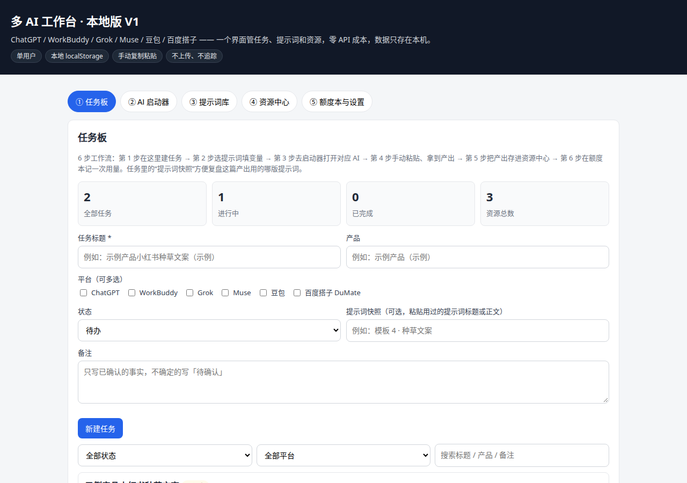
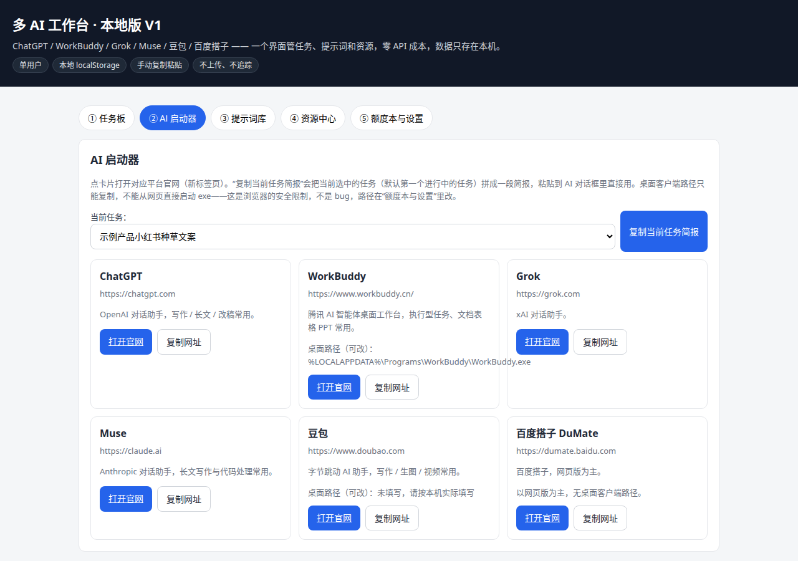
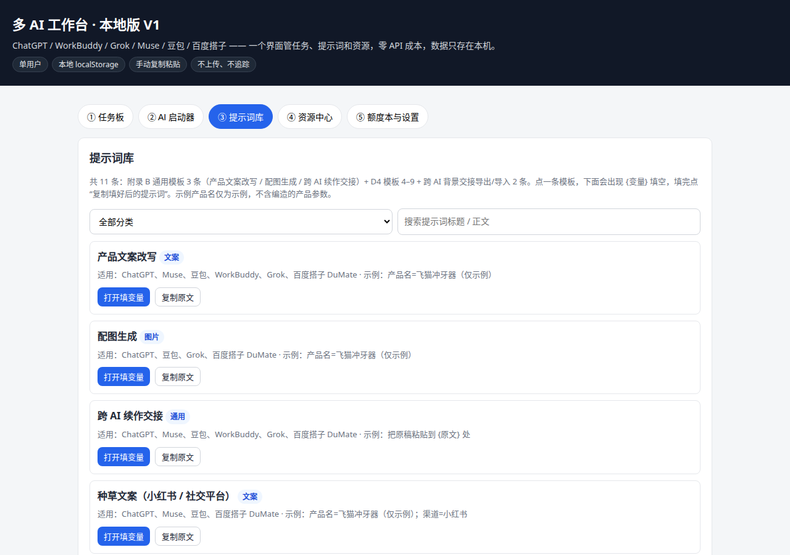
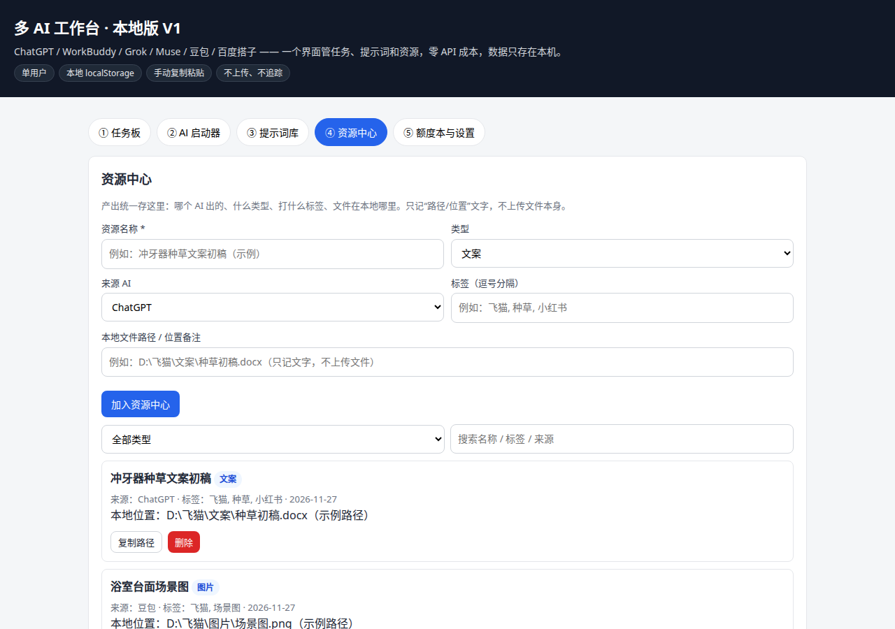
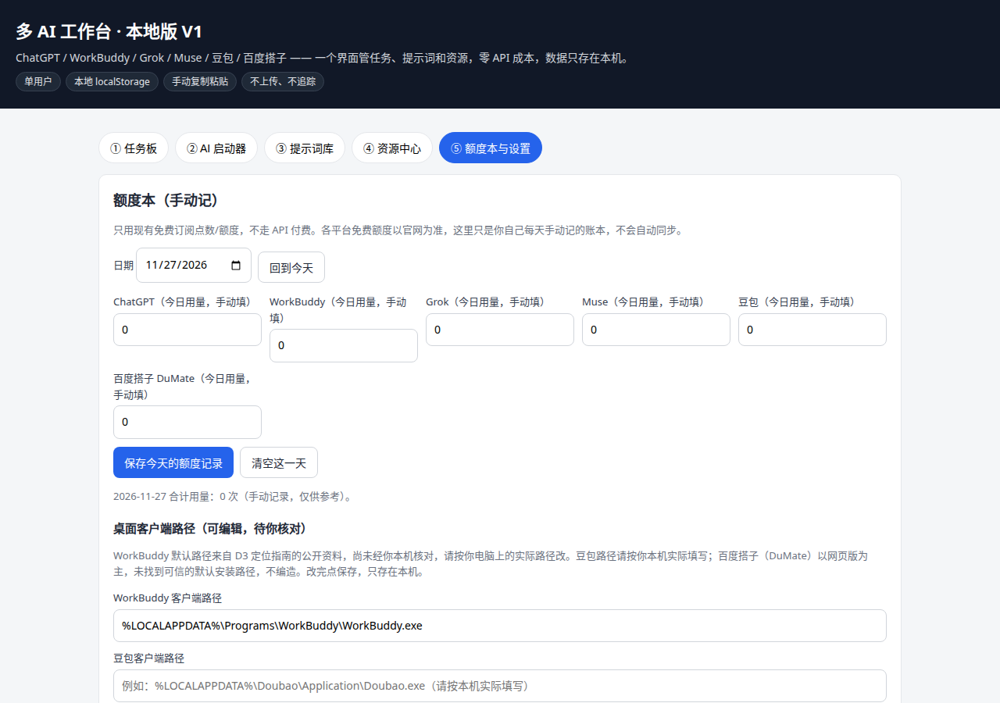
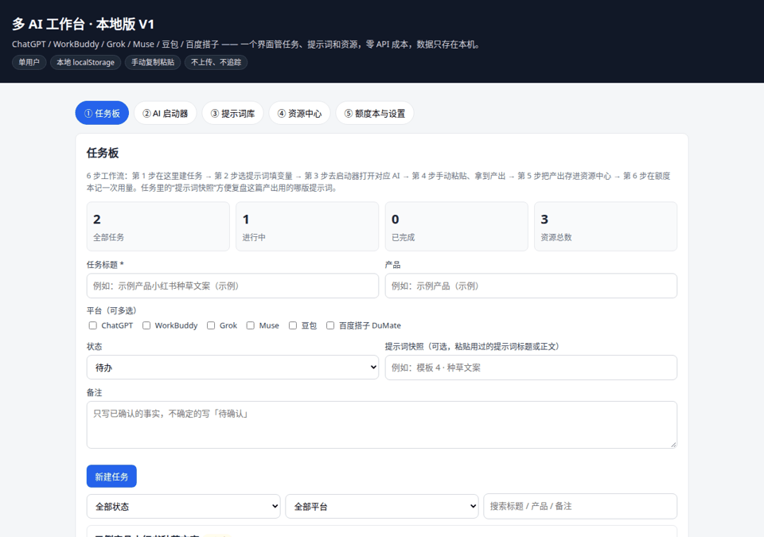

# 多 AI 工作台 · 本地版 V1

> Multi-AI Workbench (Local V1) — one local page to manage tasks, prompts and resources across ChatGPT, WorkBuddy, Grok, Muse, Doubao and Baidu DuMate. No backend, no API keys, no tracking. Data lives only in your browser.

**在线演示：[https://garyxie-ing.github.io/multi-ai-workbench/](https://garyxie-ing.github.io/multi-ai-workbench/)**（打开即用；演示页的数据只存在你自己的浏览器里，不会同步到别人那里）

**想自己用就先点右上角 Fork：Fork 后在你自己的仓库里开 Settings → Pages → main 分支 / 根目录，几分钟后访问 `https://<你的用户名>.github.io/multi-ai-workbench/` 就是你的在线版。Fork 就是使用方式。**

每天在 6 个 AI 之间切换，不用每次从头解释背景、不用到处找提示词、不用翻聊天记录找产出。这是一个**单用户、本地 Windows 工作台 + 资源中心**：任务板、AI 启动器、提示词库、资源中心、额度本，5 个模块都在一个页面里。

**零新增 API 成本**：只用你已有的免费订阅点数/额度，全程手动复制粘贴，不自动同步，不公开上传。

## 1 分钟上手（Windows）

1. 下载 / 克隆本仓库。
2. 双击 `start.bat`（或直接双击 `index.html`）。
3. 浏览器打开即用，不用安装，不用注册，不用联网（除了点开 AI 官网）。

> 第一次打开会看到 2 条示例任务和 3 条示例资源，标了“示例”，删掉换成你自己的就行。

## 5 个模块

| 模块 | 能做什么 |
|---|---|
| ① 任务板 | 新建/编辑/删除任务：标题、产品、多选平台、状态（待办/进行中/已完成）、备注、提示词快照；按状态/平台筛选、搜索、统计数；一键复制任务简报 |
| ② AI 启动器 | ChatGPT、WorkBuddy、Grok、Muse、豆包、百度搭子的官网卡片，一键打开；复制当前任务简报；桌面客户端路径可编辑（见下） |
| ③ 提示词库 | 11 条：通用模板 3 条 + D4 模板 4–9（种草文案、电商详情、GEO 长文、产品图、表格对比、视频口播）+ 跨 AI 背景交接导出/导入；按分类筛选、搜索、`{变量}` 填空、预览、一键复制 |
| ④ 资源中心 | 产出统一入库：名称、类型（文案/图片/表格/PPT/代码/视频）、标签、来源 AI、本地文件路径/位置、日期；按类型/标签搜索 |
| ⑤ 额度本与设置 | 每天手动记各平台用量（不自动同步）；桌面客户端路径设置；导出/导入 JSON 备份 |

## 6 步工作流

1. **建任务**：在任务板新建任务，选好平台，写好备注。
2. **选提示词**：去提示词库打开一条模板，填 `{变量}`，复制。
3. **打开 AI**：去启动器点开对应平台，粘贴提示词（或先粘贴“跨 AI 背景交接 · 导入提示词”+ 背景块）。
4. **拿产出**：在 AI 里拿到文案/图片/表格后，手动复制回来。
5. **存资源**：把产出存进资源中心，记好来源 AI、标签和本地路径。
6. **记额度**：在额度本记一次今天的用量。

跨 AI 换平台时：先在 A 平台粘贴“导出提示词”，复制它输出的背景块；再到 B 平台粘贴“导入提示词”+ 背景块，直接说本次要做的事。

## 提示词说明

- 提示词正文在 `data/prompts.json`，页面里也内嵌了一份（因为 `file://` 打开时浏览器不允许 fetch 本地 JSON）。改提示词请两处同步。
- 变量格式是 `{变量名}`，例如 `{产品名}`、`{核心卖点}`。填空后预览会实时更新。
- 模板里的产品名只是示例，**不含任何编造的产品参数**。实际使用时只写已确认的事实，不确定的写「待确认」。

## 桌面客户端路径（重要）

网页出于安全限制**不能直接启动本地 exe**，所以启动器里的“桌面路径”只能复制，不能一键启动。用法：复制路径 → 粘贴到文件资源管理器地址栏 → 回车打开。

- WorkBuddy 默认路径：`%LOCALAPPDATA%\Programs\WorkBuddy\WorkBuddy.exe` —— 来自公开资料，**尚未经本机核对**，请按你电脑上的实际路径在设置里改。
- 豆包：请按你本机实际路径填写，留空也可以，只用网页版。
- 百度搭子（DuMate）：以网页版 `https://dumate.baidu.com` 为主，未找到可信的默认安装路径，不编造。

## 隐私

- 所有数据存在浏览器 `localStorage`（键名 `maw_v1`），只在你本机。
- 本页面不发任何网络请求，不埋追踪，不上传文件。唯一会联网的操作是你主动点开 AI 官网。
- 换电脑、清浏览器数据会丢失数据，请定期点“导出数据（JSON）”备份；导入时用同一个文件恢复。

## 截图

> 截图为本地渲染的 V1 界面（示例数据）。

## 自己改、自己加

- 加提示词：改 `data/prompts.json` 和 `app.js` 里的 `PROMPTS`（两处同步），字段是 `id / title / category / platforms / example / body`。
- 加平台：在 `app.js` 的 `PLATFORMS` 里加一行（`id / name / url / note`），任务、启动器、资源、额度会自动出现。
- 改样式：只改 `styles.css`，不用构建。

## 参与贡献

见 [CONTRIBUTING.md](CONTRIBUTING.md)。

## 更新日志

见 [CHANGELOG.md](CHANGELOG.md)。

## License

MIT，见 [LICENSE](LICENSE)。
